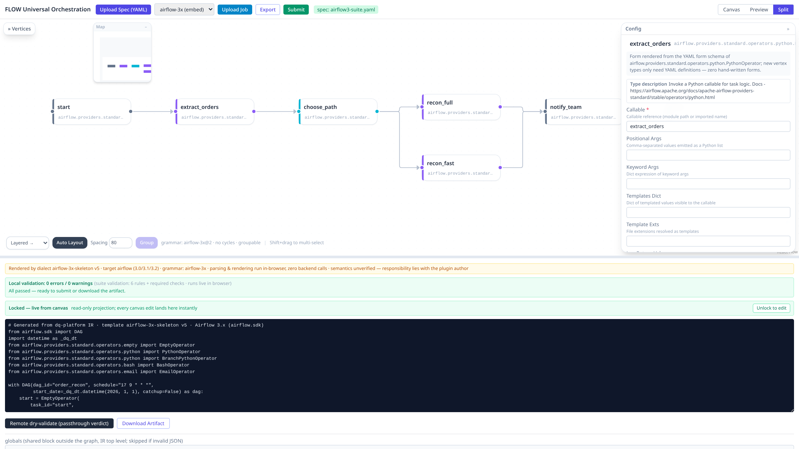
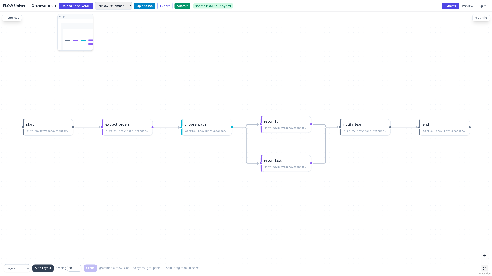
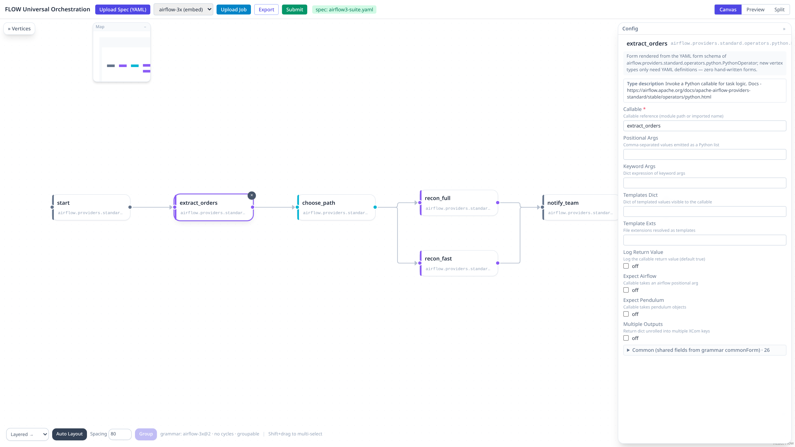
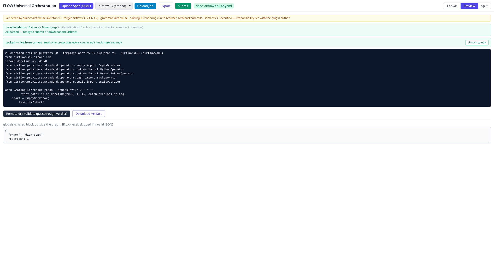

# Universal Orchestration Designer

A **pure-frontend, single-file, offline-capable** visual orchestration designer: double-click `index.html` and it runs in your browser — no backend required.

The designer ships with **zero built-in orchestration dialects**. Node types, form fields, DAG-level settings, validation rules, code-generation templates, the readback parser, and the submit logic are **all defined by an uploadable dialect-suite Spec (YAML)**. The **Airflow 3.x** suite is embedded and auto-loaded by default, so you can start drawing the moment the page opens.

[中文文档](README.zh_cn.md)

## Features

- **Zero-dependency offline use**: one HTML file, all assets inlined, opens straight from `file://`; parsing and rendering run entirely in the browser with zero backend calls
- **Spec-driven everything**: upload one YAML suite to switch dialects (Airflow / DolphinScheduler / NiFi / LangGraph / in-house flows…) — the palette, config forms, and Preview output switch along with it
- **Canvas orchestration**: drag-and-drop nodes, wire dependencies, TaskGroup grouping, multiple auto layouts (Layered / Force / Tree / Radial), minimap navigation
- **Live code generation**: the Preview panel renders the final job file in real time (e.g., Airflow DAG Python); unlock it for hand edits, and the edited text becomes the final artifact
- **Round-trip conversion**: Upload Job parses an existing job file (e.g., a `.py` DAG) back onto the canvas for further editing; Export downloads the canvas as a job file
- **Local validation**: suite-defined rules run live in the browser with instant error / warning feedback
- **One-click submit**: posts the artifact to the target service per the suite's `submitJs` contract (sent directly from the browser, identity passthrough)

## Screenshots

### Main UI (Split view: canvas + live code)

Split mode is the default on open: orchestration canvas on top, live-rendered DAG code at the bottom, with a draggable divider in between.



### Canvas view with auto layout



### Node config form (auto-generated from the Spec)

Click any node and the right-hand form is rendered entirely from that node type's `form` schema in YAML — adding a new node type takes only YAML, zero hand-written forms.



### Preview code view

The final artifact is rendered live from the suite's dialect template; once local validation passes, it is ready to download or submit.



## How to Use

### 1. Open the page

Double-click `index.html` (or deploy to any static host, e.g. GitHub Pages). The embedded **Airflow 3.x suite** loads automatically and the top bar shows `spec: airflow3-suite.yaml`.

### 2. Build a DAG

1. Drag node types from the **Vertices** palette on the left onto the canvas (35 types in the Airflow suite)
2. Drag from a node's handle to another node to wire a dependency
3. Click a node / edge / empty canvas to configure it in the **Config** panel on the right (node form, edge condition, DAG-level fields)
4. Shift+drag to select ≥2 nodes, then use **Group** (bottom-left) to wrap them in a TaskGroup
5. Switch between **Canvas / Preview / Split** at the top right; Preview shows the generated Python DAG live
6. **Export** to download the artifact, or **Submit** to post it to the service configured by the suite

### 3. Read back an existing DAG

Click **Upload Job** and pick an existing Airflow DAG `.py` file (try `docs/examples/order_recon.py`) — its tasks and dependencies are restored onto the canvas, ready for further editing and re-export.

### 4. Switch dialects

Click **Upload Spec (YAML)** and pick any suite from `suites/`:

| File | Dialect |
| --- | --- |
| `suites/airflow3-suite.yaml` | Airflow 3.x (Python DAG) |
| `suites/ds-suite.yaml` | DolphinScheduler 3.x (JSON DAG) |
| `suites/langgraph-suite.yaml` | LangGraph (Python) |
| `suites/nifi-suite.yaml` | NiFi 2.x (flow.json) |
| `suites/askchain-suite.yaml` | Ask Chain (synthetic-interval sample pack) |
| `suites/dq-agentflow-suite.yaml` | DQ agent flow (in-house) |
| `suites/dq-taskflow-suite.yaml` | DQ task workflow (in-house) |

## Repository Layout

```
.
├── index.html                  # the designer (Airflow 3.x suite embedded, ready on open)
├── suites/                     # dialect-suite Specs (Upload Spec to switch)
│   ├── airflow3-suite.yaml
│   └── ...
└── docs/
    ├── images/                 # README screenshots
    └── examples/
        └── order_recon.py      # sample DAG for trying Upload Job readback
```

> To change the default auto-loaded suite: replace the `suiteText` field of `window.__FLOW_AUTOSUITE__` in the top `<script>` of `index.html` with the full text of your target YAML.

## What's Inside a Spec

A suite YAML is a **multi-document YAML** (separated by `---`) following the `dq.platform/flow-meta/v1` contract, with three kinds of documents:

### 1. `FlowGrammar` (grammar rules, 1 doc)

Defines the meta-rules of the canvas:

- **`cycle`**: whether cycles are allowed (forbidden for Airflow; DSL-style engines may allow back edges / iteration caps)
- **`degree`**: per-node in/out degree limits
- **`group`**: grouping mechanism (Airflow TaskGroup), with group field schema and failure-notification semantics
- **`edge`**: edge field schema (e.g. `condition` → rendered as `airflow.sdk.Label`)
- **`commonForm`**: task-level fields shared by all nodes (26 in the Airflow suite: `owner`, `retries`, `trigger_rule`, `pool`, the callback family, etc.)
- **`dagFields`**: DAG-level fields (20 in the Airflow suite: `start_date`, `schedule`, `catchup`, `max_active_runs`, `deadline`, etc.)

### 2. `FlowNodeType` (node types, N docs)

Each document registers one node type. The Airflow 3.x suite ships **35 types**, grouped by category:

| Category | Count | Examples |
| --- | --- | --- |
| Scripts | 3 | PythonOperator, TaskFlowTask, BashOperator |
| Branching | 7 | BranchPythonOperator, ShortCircuitOperator, BranchSQLOperator… |
| Environments | 2 | PythonVirtualenvOperator, ExternalPythonOperator |
| Control | 4 | EmptyOperator, LatestOnlyOperator, ApprovalOperator… |
| Integration | 3 | EmailOperator, TriggerDagRunOperator, HttpOperator |
| Sensors | 9 | FileSensor, ExternalTaskSensor, HttpSensor… |
| Data / Data Quality | 1 + 5 | SQLExecuteQueryOperator, SQLTableCheckOperator… |
| Wildcard | 1 | ProviderWildcard (fallback for unregistered operators) |

Each node type carries: `opClass` (fully-qualified operator class), `category` / `color` (palette grouping and color), `description` (with official doc link), and `form` (parameter field schema).

### 3. `FlowDialectTemplate` (dialect template, 1 doc)

Defines the two-way "canvas ↔ code" conversion contract:

- **`skeleton` / `nodeRender` / `importRender` / `paramRender` / `edgeRender`**: code-generation templates (Handlebars-style) that decide every character of Preview and Export
- **`validation`**: local validation rules (6 in the Airflow suite, e.g. `bash-command-nonempty`, `trigger-rule-branch-upstream`), executed live in the page
- **`parserJs`**: the readback parser (a JS function) that parses an existing job file back onto the canvas — this powers Upload Job
- **`submitJs`**: the submit contract — target endpoint, credentials, and delivery
- **`target` / `targetVersions`**: target engine and version range (Airflow suite: `airflow` 3.0 / 3.1 / 3.2)

## Customizing a Spec

### Fastest path: edit an existing suite

Copy `suites/airflow3-suite.yaml` to a new file, edit it, then **Upload Spec (YAML)** in the page. Parsing, registration, and rendering all happen in the browser; contract violations produce explicit error messages and won't break the page.

### Add a new node type

Append a `FlowNodeType` document to the YAML:

```yaml
---
apiVersion: dq.platform/flow-meta/v1
kind: FlowNodeType
metadata: { name: SparkSubmitOperator, version: 1 }
spec:
  invocation: atomic
  managed: true
  color: orange
  category: Airflow/Integration
  description: Submit a Spark job. Docs - https://airflow.apache.org/docs/...
  opClass: airflow.providers.apache.spark.operators.spark_submit.SparkSubmitOperator
  form:
    application: { type: string, title: Application, required: true, description: Path to the Spark job }
    conf: { type: string, title: Spark Conf, format: expr, description: Dict expression of Spark configs }
    conn_id: { type: string, title: Connection ID }
```

Save → upload → the node appears in the palette instantly, with its form and code generation working out of the box.

### Field schema vocabulary

| type | Widget | Notes |
| --- | --- | --- |
| `string` | single-line input | plain text |
| `number` | numeric input | numbers |
| `boolean` | toggle | booleans |
| `enum` | dropdown | requires `options: [...]` |
| `code` | multi-line editor | large source / Markdown blocks |
| `reference` | reference | references other entities |

`format` modifiers: `expr` (Python expression, verbatim passthrough), `pylist` (comma-separated → Python list), `pyref` (callable reference). Plus `title`, `description`, `required`, `default` for form presentation and validation.

### Adjusting generation logic

- Change the artifact skeleton → edit `skeleton` in `FlowDialectTemplate`
- Change a render branch for a node class → edit `nodeRender` (branch by `node.opClass` or parameter markers)
- Change import / parameter / edge lines → `importRender` / `paramRender` / `edgeRender`
- Add pre-submit checks → append rules to `validation` (they run live in the page)

### Debugging tips

1. The Preview panel is the fastest feedback loop: upload the edited suite and canvas changes reflect immediately in the generated code
2. The local-validation panel lists every error / warning — check it before exporting
3. Semantic correctness is the suite author's responsibility — the engine only renders per contract. Run a generated DAG in a real Airflow environment once before freezing the suite

## Roadmap

- **More official suites**: complete readback parsers and submit contracts for DolphinScheduler / NiFi / LangGraph; cover more Airflow providers (Kubernetes, Docker, cloud-vendor operators)
- **Suite versioning & distribution**: a suite registry with version management — share, review, and roll out dialect definitions across a team
- **Direct engine integration**: from "submit text" to "talk to the Airflow API" — remote dry-validate, trigger DagRuns, read run status back onto the canvas
- **Canvas as an asset**: snapshot persistence and sharing (currently lost on refresh), template library, reusable subgraphs
- **Collaboration & review**: multi-user editing, change diffs, PR-style review flows for suites and DAGs
- **AI-assisted orchestration**: natural-language DAG drafting, parameter auto-completion, smart fixes for validation failures
- **CI integration**: contract tests for suite YAMLs in CI; static checks and dry-runs for generated DAGs in pipelines

## Notes

- Canvas and Preview data live only in browser memory and are **lost on refresh** — Export important artifacts promptly
- Once unlocked and hand-edited, the Preview text is final: Export / Submit use it verbatim
- Render semantics are the suite author's responsibility; the engine converts strictly per contract (the page says as much too)
